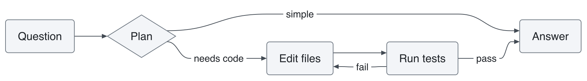

# mermaid-tui

Mermaid diagrams, drawn right in your coding agent's terminal.

When the agent answers with a ```` ```mermaid ```` block, you see the diagram instead of the source: an image where the terminal can show one, text art everywhere else.

<picture>
  <source media="(prefers-color-scheme: dark)" srcset="docs/demo-dark.png">
  
</picture>

| Harness | Status |
| --- | --- |
| [Claude Code](#claude-code) | Supported |

## Claude Code

### Install

```
/plugin install mermaid --marketplace what1f/mermaid-tui
```

For images, install `rsvg-convert`:

```
brew install librsvg
```

### How it draws

| Where | What you get |
| --- | --- |
| kitty, Ghostty | An image |
| Other terminals with the kitty graphics protocol (WezTerm, Rex…) | An image, once `CLAUDE_CODE_FORCE_TERMINAL_IMAGES=1` is set |
| Any other terminal | Text art, fitted to the width |
| Desktop app, editor extensions | SVG |

Text art looks like this:

```
┌─────┐                 ┌────────┐         ┌──────┐
│ You │                 │ Claude │         │ Repo │
└──┬──┘                 └────┬───┘         └───┬──┘
   │                         │                 │
   │ Explain the login flow  │                 │
   ├────────────────────────▶│                 │
   │                         │                 │
   │                         │ Read auth code  │
   │                         ├────────────────▶│
   │                         │                 │
   │                         │     Files       │
   │                         │◀┄┄┄┄┄┄┄┄┄┄┄┄┄┄┄┄┤
   │                         │                 │
   │        Diagram          │                 │
   │◀┄┄┄┄┄┄┄┄┄┄┄┄┄┄┄┄┄┄┄┄┄┄┄┄┤                 │
   │                         │                 │
┌──┴──┐                 ┌────┴───┐         ┌───┴──┐
│ You │                 │ Claude │         │ Repo │
└─────┘                 └────────┘         └──────┘
```

A block that is still streaming stays a code block until it closes. A diagram that does not parse, or is too wide for text art, stays a code block too. Only the display changes: Claude still reads the Mermaid source.

### Options

**Drawing**, in `/config`: `auto` (default), `image`, `text` or `off`.

### Theme

Images follow the Claude Code theme: a light theme draws light, a dark theme dark, and `auto` follows the system appearance.

To change colors or type, create `~/.claude/mermaid-tui-theme.json`. Every key is optional; the next diagram drawn picks up the change.

```json
{
  "appearance": "auto",
  "fontSize": 14,
  "font": "PingFang SC",
  "radius": 6,
  "light": { "fg": "#1f2328", "line": "#424a53", "surface": "#f3f5f8", "border": "#6e7781", "accent": "#0969da" },
  "dark": { "fg": "#e8eaed", "line": "#c2c8d1", "surface": "#262a31", "border": "#8b939e", "accent": "#6ea8fe" }
}
```

| Key | What it sets |
| --- | --- |
| `appearance` | `auto` (follow Claude Code), `light` or `dark` |
| `fontSize`, `font`, `fontMono` | Label size in px and font families |
| `radius` | Corner radius in px |
| `bg` | Behind labels that sit on lines |
| `fg`, `muted` | Text, secondary text |
| `line`, `border` | Edges, node outlines |
| `surface`, `surfaceAlt` | Node fills |
| `accent`, `critical` | Highlights, critical items |
| `series` | List of colors for pie slices and chart series |

Color keys at the top level apply to both appearances; keys under `light` or `dark` apply to that one only.

## Diagrams

Flowcharts, sequence, class, state, ER, Gantt, pie, mindmap, timeline, gitGraph, journey, quadrant, XY, sankey, C4, architecture, kanban and more.

## Credits

Diagrams are drawn by [pele](https://github.com/obsidianmd/pele), from [a fork](https://github.com/what1f/pele/tree/ascii) that adds text art.

## Development

| Folder | What it holds |
| --- | --- |
| `core/` | What every harness shares: finding Mermaid blocks, colors, image sizing |
| `claude-code/` | The Claude Code plugin |

Claude Code installs a plugin by copying its folder alone, so `pnpm build` copies `core/` and pele into `claude-code/hooks/`, and the copies are committed. Edit `core/`, not the copies. To update pele, change its release URL in `package.json`, then:

```
pnpm install
pnpm build
```

CI checks that the committed copies are current.

## License

MIT
