<h1 align="center">mermaid-tui</h1>

<p align="center">Mermaid diagrams, drawn in your coding agent's terminal.</p>

<p align="center"><b>English</b> | <a href="README.zh-CN.md">简体中文</a></p>

<p align="center">
  <picture>
    <source media="(prefers-color-scheme: dark)" srcset="docs/demo-claude-code-dark.gif">
    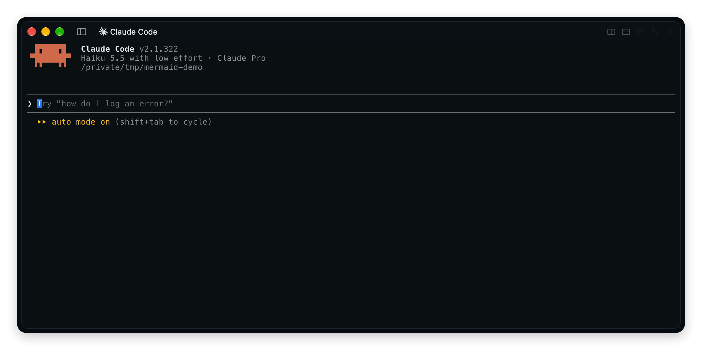
  </picture>
</p>

When the agent answers with a ```` ```mermaid ```` block, you see the diagram, not the source. Terminals that show images get a sharp picture in your theme's colors. Every other terminal gets text art, fitted to the width.

Works in [Claude Code](#claude-code) and [pi](#pi).

## Install

### Claude Code

```
/plugin install mermaid --marketplace what1f/mermaid-tui
```

Images need `rsvg-convert`:

```
brew install librsvg
```

| Where | What you get |
| --- | --- |
| kitty, Ghostty | An image |
| Other terminals with the kitty graphics protocol (WezTerm, Rex…) | An image, with `CLAUDE_CODE_FORCE_TERMINAL_IMAGES=1` set |
| Any other terminal | Text art |
| Desktop app, editor extensions | SVG |

To pick one way of drawing, set **Drawing** in `/config`: `auto` (default), `image`, `text` or `off`.

### pi

```
pi install git:github.com/what1f/mermaid-tui
```

Then turn off **Mermaid diagrams** in `/settings`. That is pi's own text drawing; with it off, mermaid-tui draws the blocks. Images need `rsvg-convert` here too, and show in terminals pi draws images in.

<p align="center">
  <picture>
    <source media="(prefers-color-scheme: dark)" srcset="docs/demo-pi-dark.gif">
    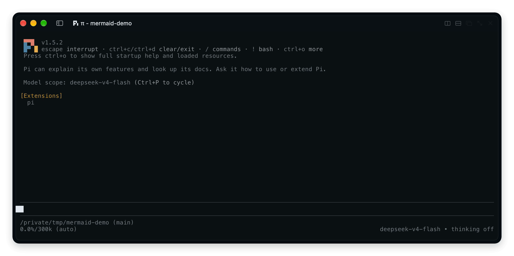
  </picture>
</p>

## Text art

No image support? The same diagram comes out as text art, sized to the terminal.

<p align="center">
  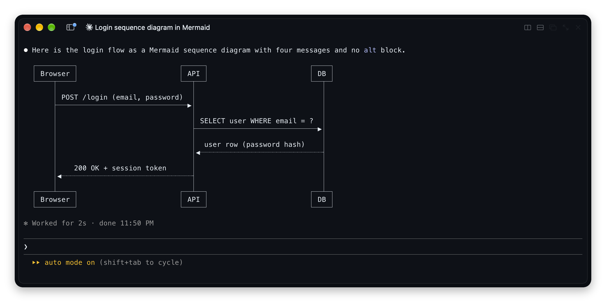
</p>

## Gallery

<table>
  <tr>
    <th>Image</th>
    <th>Text art</th>
  </tr>
  <tr>
    <td align="center">
      <picture>
        <source media="(prefers-color-scheme: dark)" srcset="docs/gallery/flowchart-dark.png">
        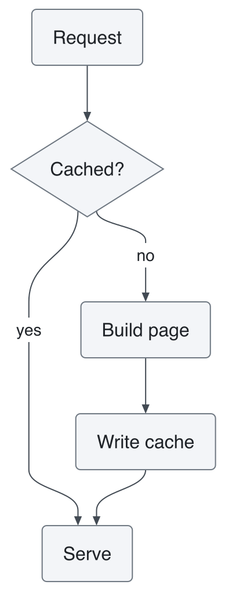
      </picture>
    </td>
    <td align="center">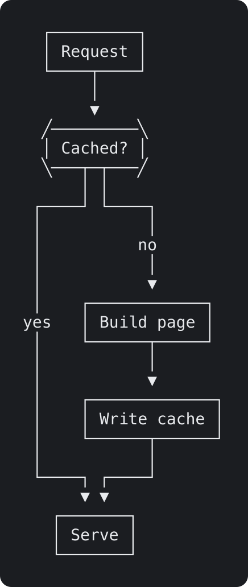</td>
  </tr>
  <tr>
    <td align="center">
      <picture>
        <source media="(prefers-color-scheme: dark)" srcset="docs/gallery/sequence-dark.png">
        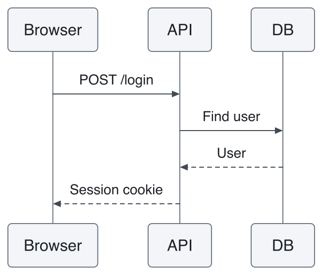
      </picture>
    </td>
    <td align="center">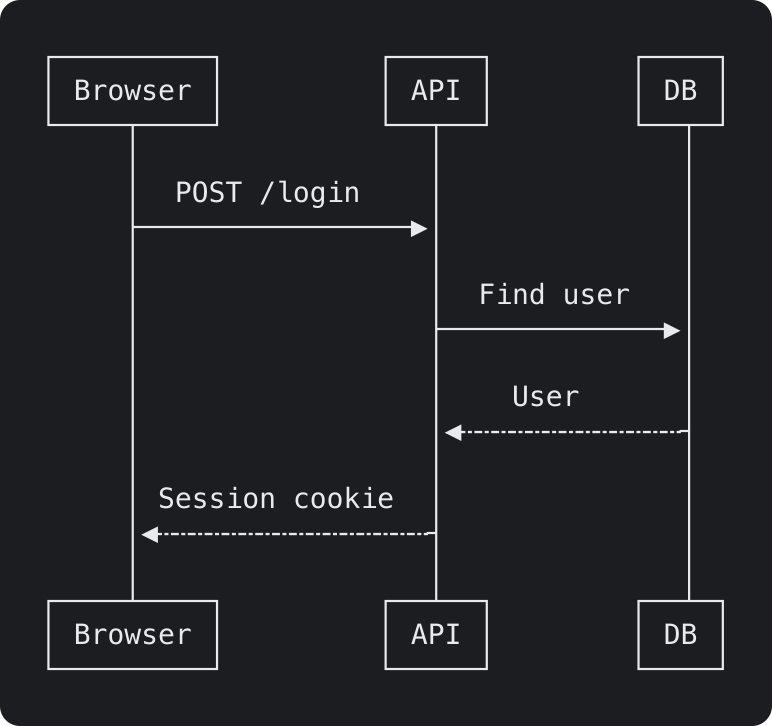</td>
  </tr>
  <tr>
    <td align="center">
      <picture>
        <source media="(prefers-color-scheme: dark)" srcset="docs/gallery/state-dark.png">
        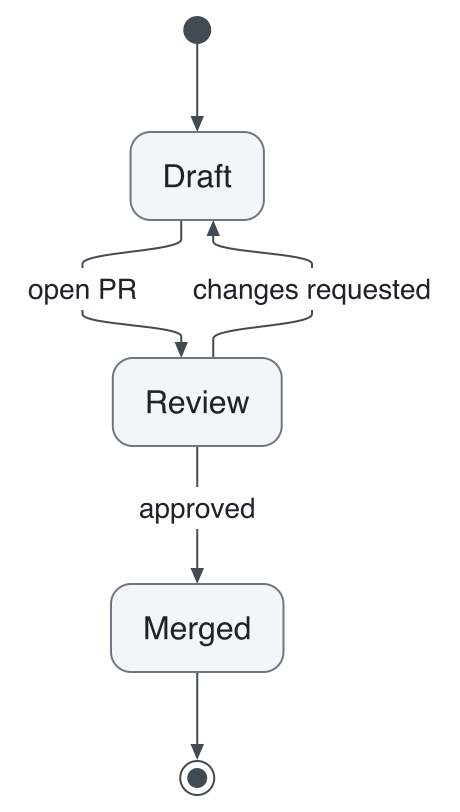
      </picture>
    </td>
    <td align="center">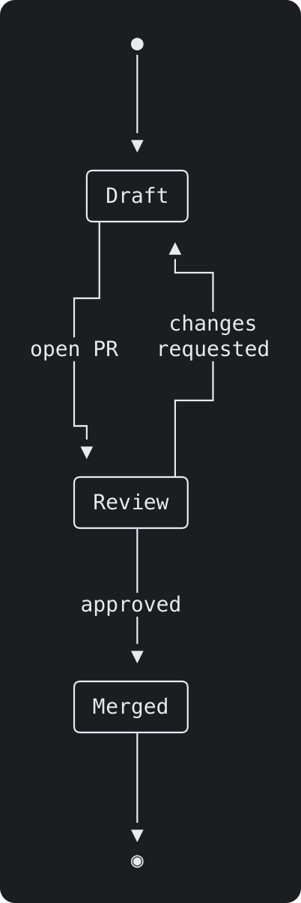</td>
  </tr>
  <tr>
    <td align="center">
      <picture>
        <source media="(prefers-color-scheme: dark)" srcset="docs/gallery/class-dark.png">
        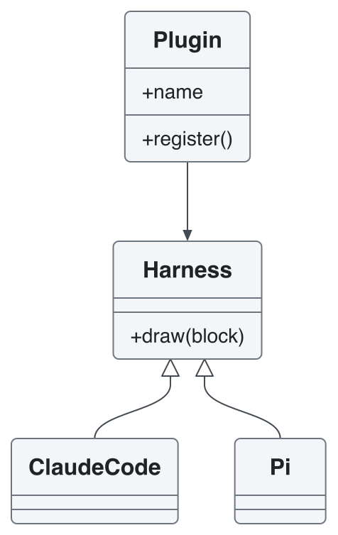
      </picture>
    </td>
    <td align="center">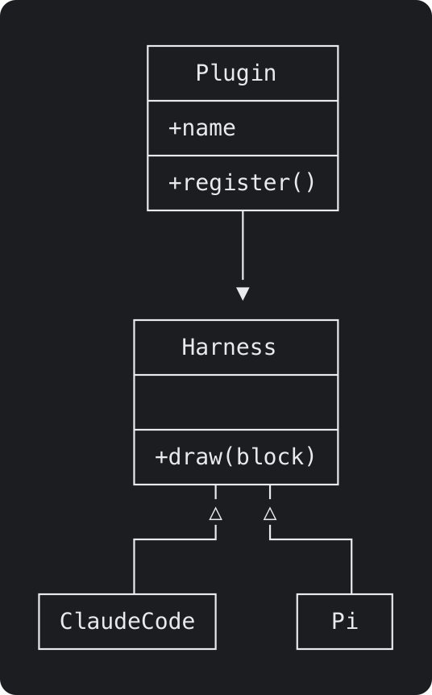</td>
  </tr>
  <tr>
    <td align="center">
      <picture>
        <source media="(prefers-color-scheme: dark)" srcset="docs/gallery/er-dark.png">
        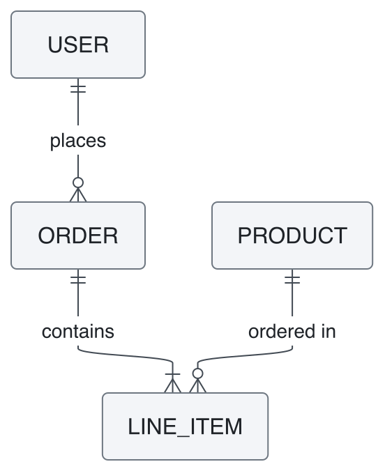
      </picture>
    </td>
    <td align="center">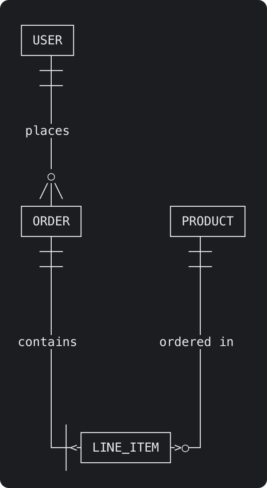</td>
  </tr>
  <tr>
    <td align="center">
      <picture>
        <source media="(prefers-color-scheme: dark)" srcset="docs/gallery/pie-dark.png">
        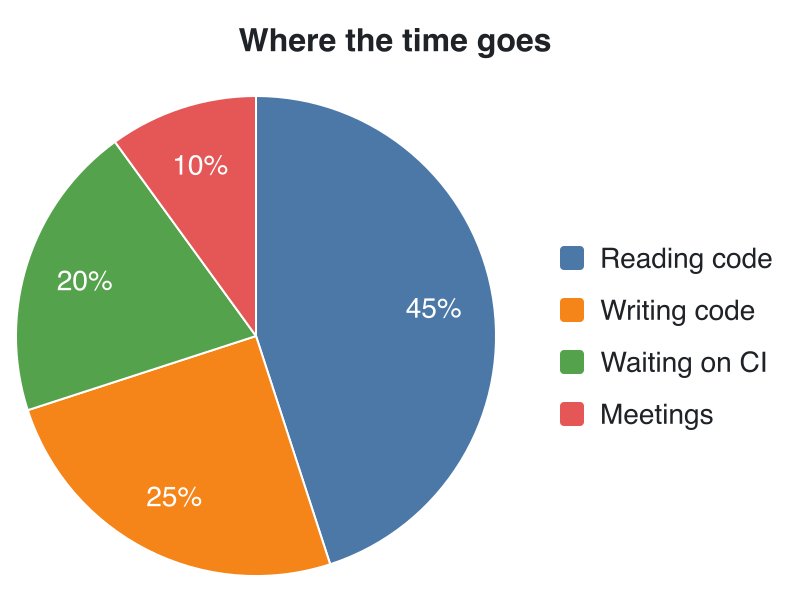
      </picture>
    </td>
    <td align="center">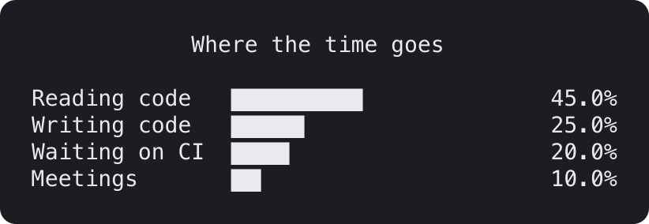</td>
  </tr>
</table>

Every Mermaid diagram type draws both ways: Gantt, mindmap, timeline, git graph, C4, architecture, kanban and the rest. See them all as text in [the pele/ascii gallery](https://github.com/what1f/pele/blob/ascii/GALLERY.md).

A block that is still streaming stays a code block until it closes, and so does one that does not parse. Only the display changes: the agent still reads the Mermaid source.

## Theme

Images follow the agent's theme: a light theme draws light, a dark theme dark, and `auto` follows the system.

<details>
<summary>Change colors and type</summary>

Create `mermaid-tui-theme.json` in `~/.claude/` for Claude Code, or in `~/.pi/agent/` for pi. Every key is optional; the next diagram drawn picks up the change.

```json
{
  "appearance": "auto",
  "fontSize": 14,
  "font": "PingFang SC",
  "radius": 6,
  "light": { "fg": "#1f2328", "line": "#424a53", "surface": "#f3f5f8", "border": "#6e7781", "accent": "#0969da" },
  "dark": { "fg": "#e8eaed", "line": "#c2c8d1", "surface": "#262a31", "border": "#8b939e", "accent": "#6ea8fe" }
}
```

| Key | What it sets |
| --- | --- |
| `appearance` | `auto` (follow the agent), `light` or `dark` |
| `fontSize`, `font`, `fontMono` | Label size in px and font families |
| `radius` | Corner radius in px |
| `bg` | Behind labels that sit on lines |
| `fg`, `muted` | Text, secondary text |
| `line`, `border` | Edges, node outlines |
| `surface`, `surfaceAlt` | Node fills |
| `accent`, `critical` | Highlights, critical items |
| `series` | List of colors for pie slices and chart series |

Color keys at the top level apply to both appearances; keys under `light` or `dark` apply to that one only.

</details>

## Built on pele

Images are drawn by [pele](https://github.com/obsidianmd/pele), a small Mermaid-to-SVG renderer. Text art comes from [pele/ascii](https://github.com/what1f/pele), our fork that gives pele a second output: the same Mermaid source, drawn with box-drawing characters.

- **Every type.** All 32 diagram types pele draws as SVG also draw as text, each with a layout of its own.
- **Clean joins.** Lines are tracked per cell, so an edge meets a box as `├` and crosses another as `┼`.
- **Fits the width.** When a diagram is too wide, it is laid out again: tighter spacing, wrapped labels, and top-down instead of left-to-right if needed.
- **Wide characters.** Chinese, Japanese, Korean and emoji take two columns, so boxes stay aligned.
- **Plain ASCII.** `charset: 'ascii'` draws with `+ - |` only, for logs and terminals without Unicode.

pele/ascii works on its own too; see [its README](https://github.com/what1f/pele).

## Development

| Folder | What it holds |
| --- | --- |
| `core/` | What every harness shares: finding Mermaid blocks, colors, image sizing |
| `claude-code/` | The Claude Code plugin |
| `pi/` | The pi extension |
| `scripts/` | The build, and the gallery images above |

pi installs the whole repository, so `pi/` uses `core/` as is. Claude Code installs a plugin by copying its folder alone, so `pnpm build` copies `core/` and pele into `claude-code/hooks/`, and the copies are committed. Edit `core/`, not the copies. To update pele, change its release URL in `package.json`, then:

```
pnpm install
pnpm build
```

CI checks that the committed copies are current. `node scripts/gallery.mjs` redraws the gallery.

## License

MIT
