<h1 align="center">mermaid-tui</h1>

<p align="center">在编程 Agent 的终端里，直接看到 Mermaid 图。</p>

<p align="center"><a href="README.md">English</a> | <b>简体中文</b></p>

<p align="center">
  <picture>
    <source media="(prefers-color-scheme: dark)" srcset="docs/demo-claude-code-dark.gif">
    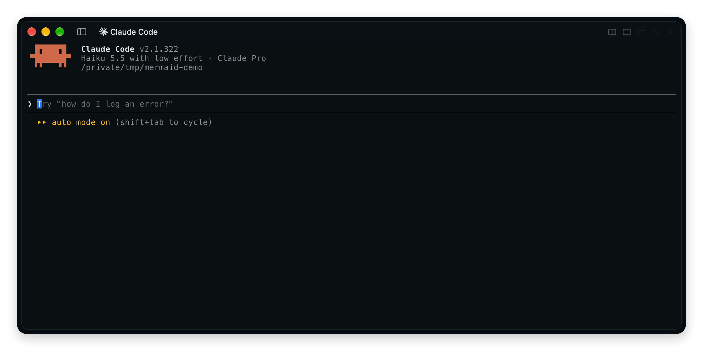
  </picture>
</p>

Agent 回复里出现 ```` ```mermaid ```` 代码块时，你看到的是图，而不是源码。能显示图片的终端里，是一张跟随主题配色的清晰图片；其他终端里，是按宽度排好的字符图。

支持 [Claude Code](#claude-code) 和 [pi](#pi)。

## 安装

### Claude Code

```
/plugin install mermaid --marketplace what1f/mermaid-tui
```

显示图片需要 `rsvg-convert`：

```
brew install librsvg
```

| 在哪里 | 显示成什么 |
| --- | --- |
| kitty、Ghostty | 图片 |
| 其他支持 kitty 图形协议的终端（WezTerm、Rex…） | 设置 `CLAUDE_CODE_FORCE_TERMINAL_IMAGES=1` 后显示图片 |
| 其他终端 | 字符图 |
| 桌面版、编辑器插件 | SVG |

想固定一种画法，在 `/config` 里设置 **Drawing**：`auto`（默认）、`image`、`text` 或 `off`。

### pi

```
pi install git:github.com/what1f/mermaid-tui
```

然后在 `/settings` 里关掉 **Mermaid diagrams**（pi 自带的字符图），改由 mermaid-tui 来画。这里显示图片同样需要 `rsvg-convert`，pi 能显示图片的终端里就会出图。

<p align="center">
  <picture>
    <source media="(prefers-color-scheme: dark)" srcset="docs/demo-pi-dark.gif">
    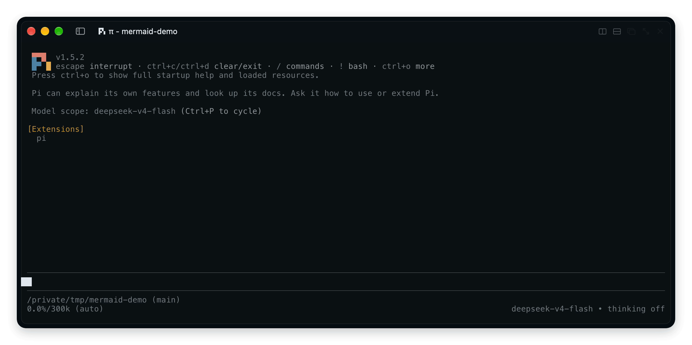
  </picture>
</p>

## 字符图

终端不支持图片时，同一张图会画成字符图，宽度自动适配终端。

<p align="center">
  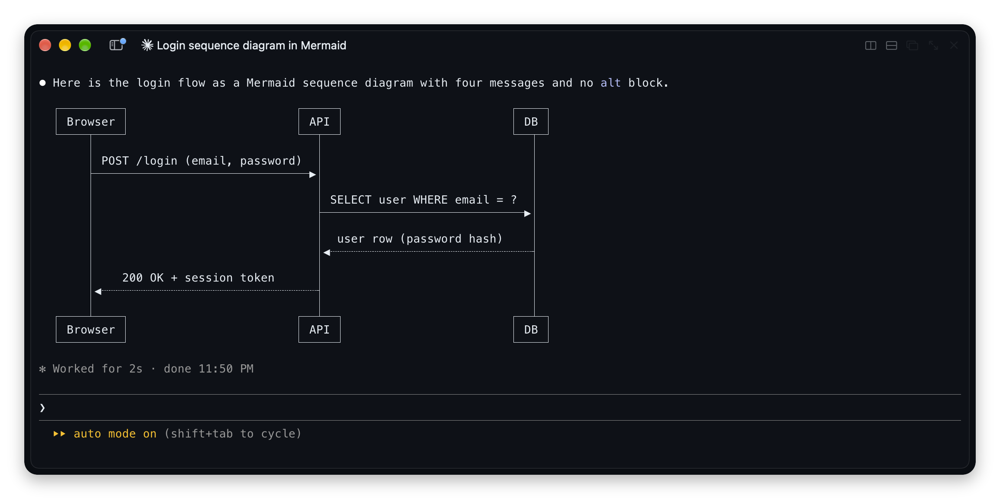
</p>

## 图库

<table>
  <tr>
    <th>图片</th>
    <th>字符图</th>
  </tr>
  <tr>
    <td align="center">
      <picture>
        <source media="(prefers-color-scheme: dark)" srcset="docs/gallery/flowchart-dark.png">
        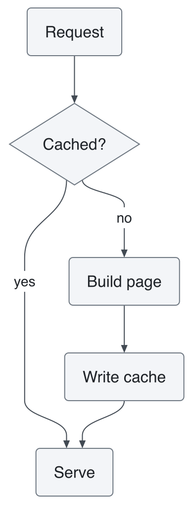
      </picture>
    </td>
    <td align="center">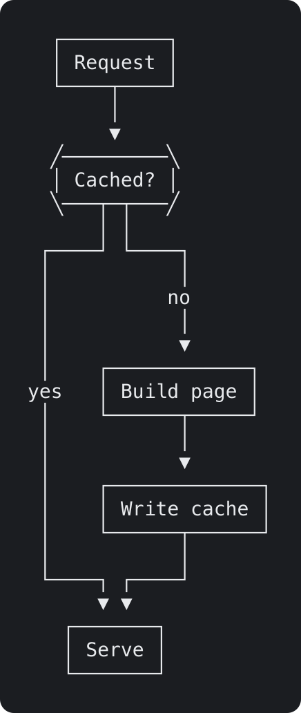</td>
  </tr>
  <tr>
    <td align="center">
      <picture>
        <source media="(prefers-color-scheme: dark)" srcset="docs/gallery/sequence-dark.png">
        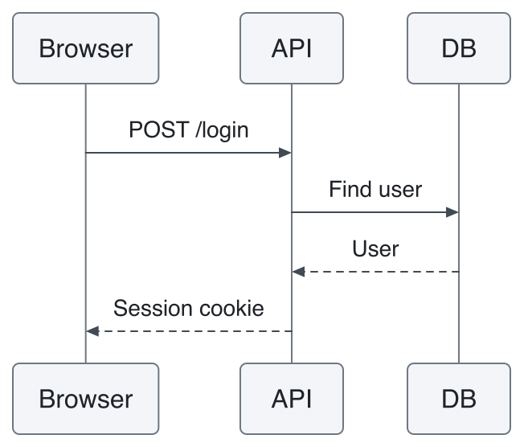
      </picture>
    </td>
    <td align="center">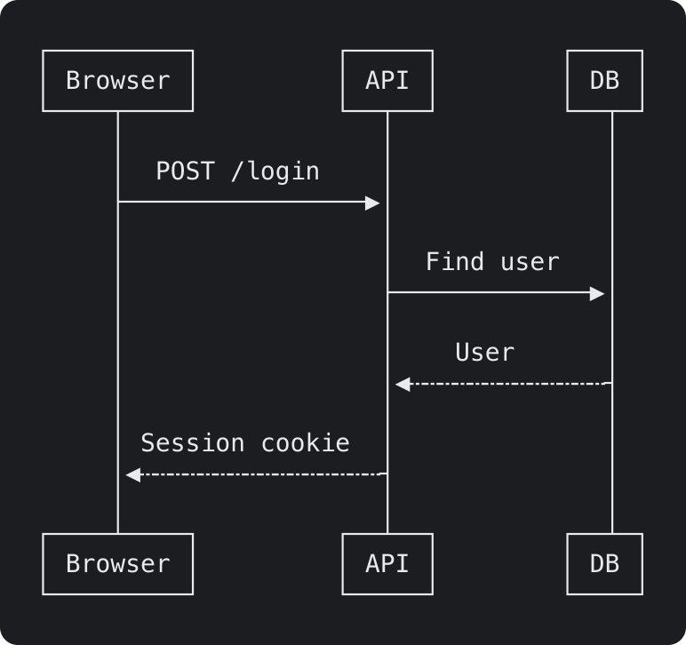</td>
  </tr>
  <tr>
    <td align="center">
      <picture>
        <source media="(prefers-color-scheme: dark)" srcset="docs/gallery/state-dark.png">
        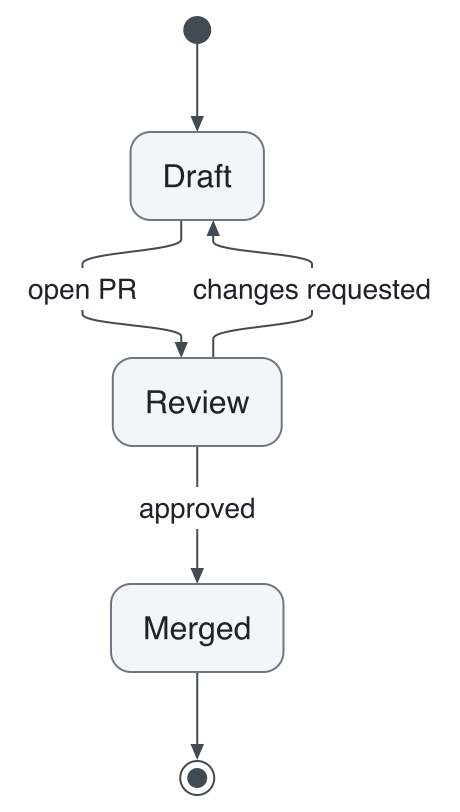
      </picture>
    </td>
    <td align="center">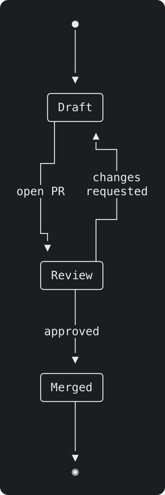</td>
  </tr>
  <tr>
    <td align="center">
      <picture>
        <source media="(prefers-color-scheme: dark)" srcset="docs/gallery/class-dark.png">
        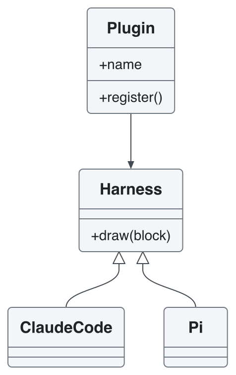
      </picture>
    </td>
    <td align="center">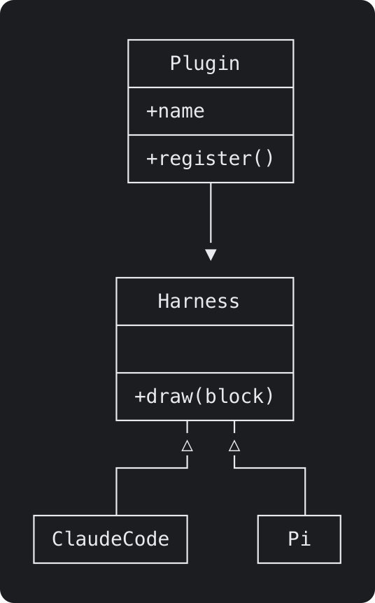</td>
  </tr>
  <tr>
    <td align="center">
      <picture>
        <source media="(prefers-color-scheme: dark)" srcset="docs/gallery/er-dark.png">
        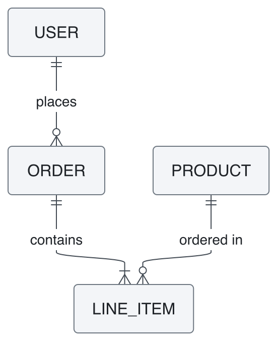
      </picture>
    </td>
    <td align="center">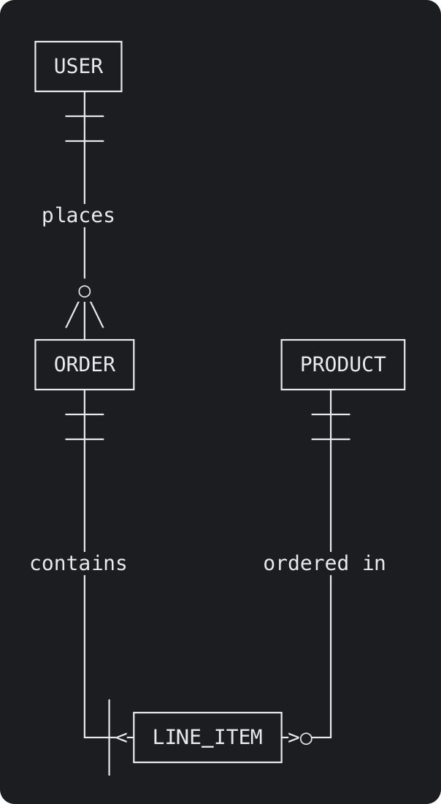</td>
  </tr>
  <tr>
    <td align="center">
      <picture>
        <source media="(prefers-color-scheme: dark)" srcset="docs/gallery/pie-dark.png">
        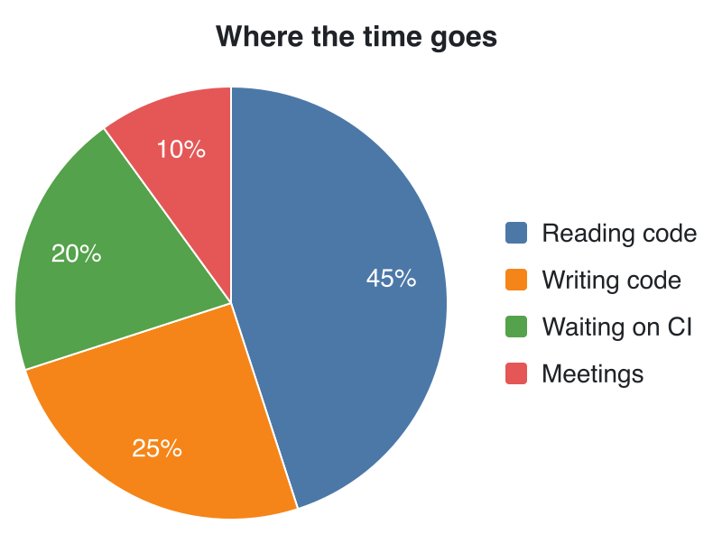
      </picture>
    </td>
    <td align="center">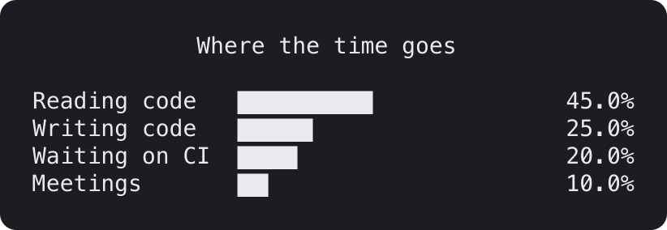</td>
  </tr>
</table>

所有 Mermaid 图表类型都能画成这两种：甘特图、思维导图、时间线、Git 图、C4、架构图、看板等等。全部类型的字符图效果见 [pele/ascii 图库](https://github.com/what1f/pele/blob/ascii/GALLERY.md)。

代码块还在流式输出、或者解析不了时，照原样显示。变的只是显示，Agent 读到的仍然是 Mermaid 源码。

## 主题

图片跟随 Agent 的主题：亮色主题画亮色，暗色主题画暗色，`auto` 跟随系统。

<details>
<summary>修改颜色和字体</summary>

Claude Code 在 `~/.claude/`、pi 在 `~/.pi/agent/` 下新建 `mermaid-tui-theme.json`。所有字段都可以不填，改完后画下一张图时生效。

```json
{
  "appearance": "auto",
  "fontSize": 14,
  "font": "PingFang SC",
  "radius": 6,
  "light": { "fg": "#1f2328", "line": "#424a53", "surface": "#f3f5f8", "border": "#6e7781", "accent": "#0969da" },
  "dark": { "fg": "#e8eaed", "line": "#c2c8d1", "surface": "#262a31", "border": "#8b939e", "accent": "#6ea8fe" }
}
```

| 字段 | 作用 |
| --- | --- |
| `appearance` | `auto`（跟随 Agent）、`light` 或 `dark` |
| `fontSize`、`font`、`fontMono` | 文字大小（px）和字体 |
| `radius` | 圆角（px） |
| `bg` | 连线上标签的底色 |
| `fg`、`muted` | 文字、次要文字 |
| `line`、`border` | 连线、节点边框 |
| `surface`、`surfaceAlt` | 节点填充色 |
| `accent`、`critical` | 强调、关键项 |
| `series` | 饼图扇区和图表系列的颜色列表 |

写在顶层的颜色对亮色和暗色都生效；写在 `light` 或 `dark` 下的只对那一种生效。

</details>

## 基于 pele

图片由 [pele](https://github.com/obsidianmd/pele) 绘制，它是一个小巧的 Mermaid 转 SVG 渲染器。字符图来自我们的 fork [pele/ascii](https://github.com/what1f/pele)，它给 pele 加了第二种输出：同一份 Mermaid 源码，用框线字符画出来。

- **全部类型。** pele 能画成 SVG 的 32 种图，都能画成字符图，每种都有自己的排版。
- **交汇整齐。** 线条按格子记录走向，连线接到框上是 `├`，两条线交叉是 `┼`。
- **自适应宽度。** 图超出终端宽度时会重新排版：收紧间距、标签折行，必要时把横向改成纵向。
- **宽字符。** 中日韩文字和 emoji 占两列，框线始终对齐。
- **纯 ASCII。** `charset: 'ascii'` 只用 `+ - |` 画，适合日志和不支持 Unicode 的终端。

pele/ascii 也可以单独使用，见[它的 README](https://github.com/what1f/pele)。

## 开发

| 目录 | 内容 |
| --- | --- |
| `core/` | 各个 Agent 共用的部分：找出 Mermaid 代码块、配色、图片尺寸 |
| `claude-code/` | Claude Code 插件 |
| `pi/` | pi 扩展 |
| `scripts/` | 构建脚本，以及生成上面图库的脚本 |

pi 安装的是整个仓库，所以 `pi/` 直接引用 `core/`。Claude Code 安装插件时只复制插件目录，所以 `pnpm build` 会把 `core/` 和 pele 复制到 `claude-code/hooks/`，复制出来的文件也提交到仓库。改代码请改 `core/`，不要改副本。升级 pele 时，修改 `package.json` 里它的 release 地址，然后：

```
pnpm install
pnpm build
```

CI 会检查提交的副本是否最新。`node scripts/gallery.mjs` 会重新生成图库。

## 许可证

MIT
